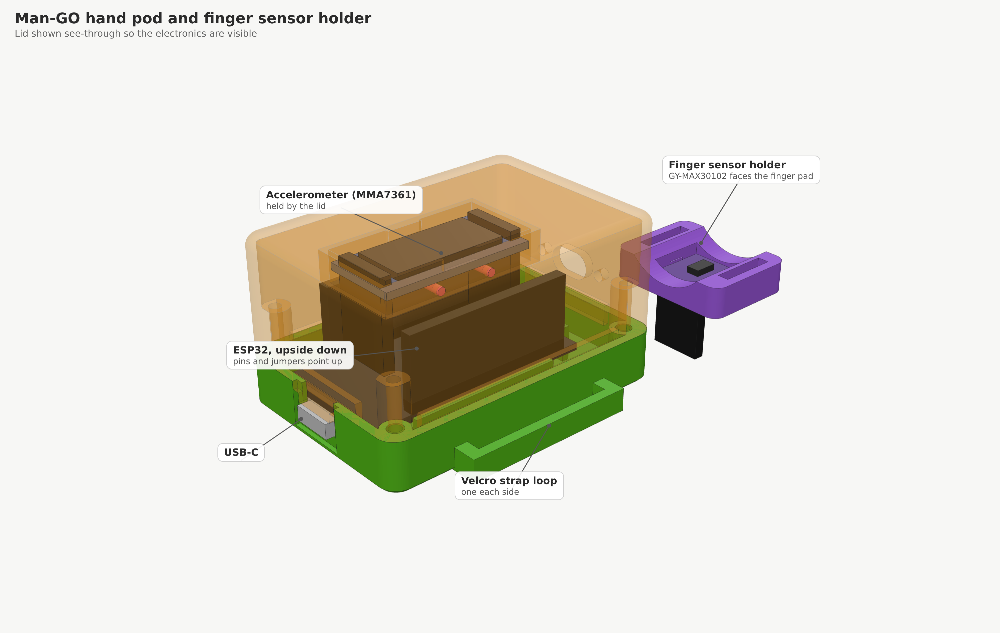
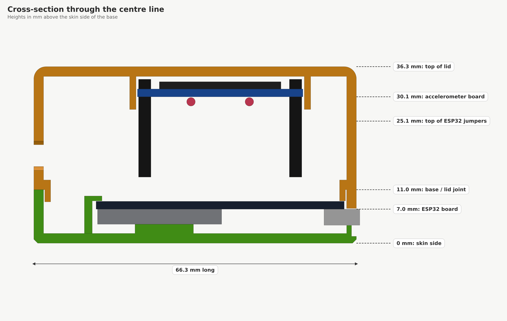
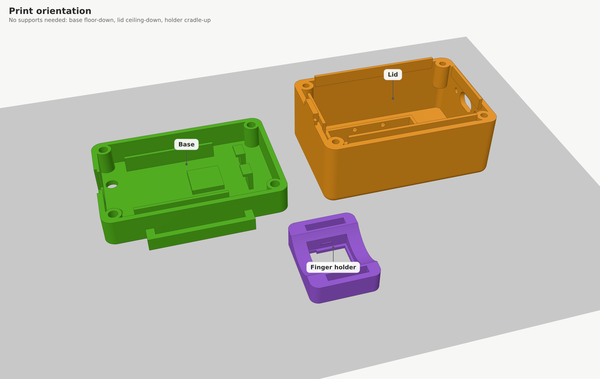
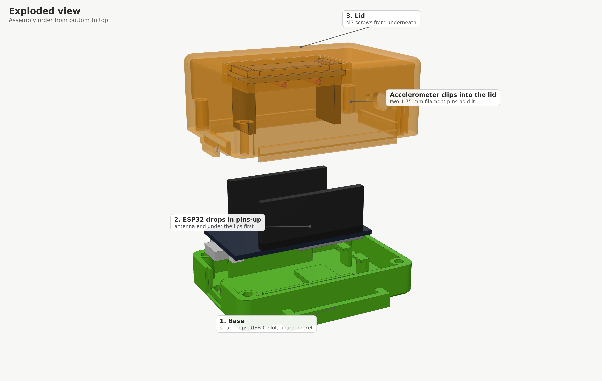
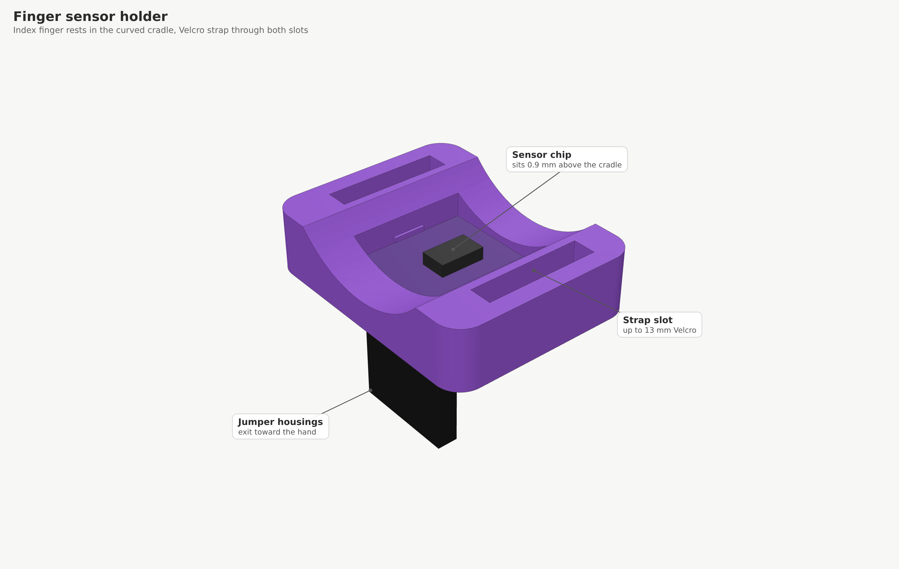

# Wristband CAD

3D-printable housing for the first wearable test: a pod on the back of the hand that holds the
ESP32 and MMA7361 with all the jumper wires, and a holder that keeps the GY-MAX30102 against the
index-finger pad. Both attach with Velcro straps.



## Files

| File | What it is |
|---|---|
| `output/hand_pod_base.stl` / `.step` | Base: holds the ESP32 upside down (pins up), USB-C slot, strap loops |
| `output/hand_pod_lid.stl` / `.step` | Lid: covers the wiring, holds the accelerometer, finger-cable exit |
| `output/finger_sensor_holder.stl` / `.step` | Finger holder for the GY-MAX30102 |
| `output/assembly.step` | Everything assembled with simple stand-in electronics, for viewing in Fusion 360, SolidWorks or Onshape |
| `wristband_cad.py` | Parametric source. Every dimension is a named parameter at the top |
| `check_fit.py` | Checks that no printed part collides with the electronics |
| `renders/` | Pictures of the design |

The STL files are already in printing orientation.

## Sizes

- Pod: 66.3 × 45.9 × 36.3 mm (56.7 mm wide including the strap loops)
- Finger holder: 24 × 31 × 7.5 mm
- About 70 cm³ of free space inside the pod for wire loops



## Measure before printing

The ESP32 size was measured from photos using the 2.54 mm pin spacing. The other modules were
estimated, so check these with calipers or a ruler. If one is off by more than about 0.5 mm,
change it in `wristband_cad.py` and re-run.

| Parameter | Current value | What to measure |
|---|---|---|
| `ESP_L`, `ESP_W` | 51.0 × 27.5 mm | ESP32 board outline (the pocket accepts up to 51.8 × 28.6) |
| `MMA_L`, `MMA_W` | 34.0 × 17.0 mm | MMA7361 board outline |
| `MAX_L`, `MAX_W` | 14.0 × 14.0 mm | GY-MAX30102 board. `MAX_W` runs along the pin row |
| `MODULE_H` | 3.1 mm | Height of the ESP32's metal module above its board |

## Printing

- PLA or PETG, 0.2 mm layers, 3 walls, 20 % infill, **no supports**
- Base floor-down, lid ceiling-down, finger holder cradle-up (as the STLs are saved)
- Roughly 33 cm³ of plastic in total. All three parts fit on one bed



## Other parts needed

- 4 × M3 flat-head (countersunk) screws, 16 to 20 mm long, self-tapping or machine screws
- 2 × 21 mm pieces of 1.75 mm filament (they pin the accelerometer into the lid)
- Velcro strap about 25 mm wide for the hand, and one about 12 mm wide for the finger
- Optional: thin foam or felt on the underside of the pod for comfort

## Assembly



1. **Accelerometer into the lid.** Push the MMA7361 into the frame inside the lid, chip side
   toward the lid's ceiling, so its jumpers hang down. Slide the two filament pieces through the
   holes in the frame, under the board.
2. **ESP32 into the base.** Pins and jumpers point up. Tilt the board and slide the end opposite
   the USB-C under the two lips, then lower the USB end so the USB-C drops into its slot.
3. **Wires.** Connect the jumpers as before (pin table in `../wiring.md`). Tuck spare wire into
   the spaces beside the ESP32; a twist tie on the slack helps. Run the four pulse-sensor wires out
   through the oval opening at the finger end and zip-tie them through the two small holes beside it.
4. **Close.** Lower the lid; its tab drops into the USB slot and holds the USB-C down. Fit the four
   M3 screws from underneath.
5. **Hand strap.** Thread the 25 mm Velcro through both side loops and around the palm. The USB-C
   end points toward the wrist.
6. **Finger holder.** Press the GY-MAX30102 into the pocket with the sensor facing up (toward the
   finger) and the pins at the hand end, so the jumpers stick out underneath. Thread the narrow
   strap through both slots and around the fingertip. The sensor reads best snug but not tight.

The holes in the base floor line up with the ESP32's EN and BOOT buttons, so you can press them
with a paperclip when the pod is off your hand.



## Editing the design

```
pip install build123d
python wristband_cad.py     # writes output/*.step, output/*.stl
python check_fit.py         # reports any collisions (should print "problems: 0")
```

`SIDE_WIRE_SPACE` and `END_SPACE` set how much room there is for wire loops. Shorter jumpers
(10 cm) would let you shrink both and make the pod smaller.
